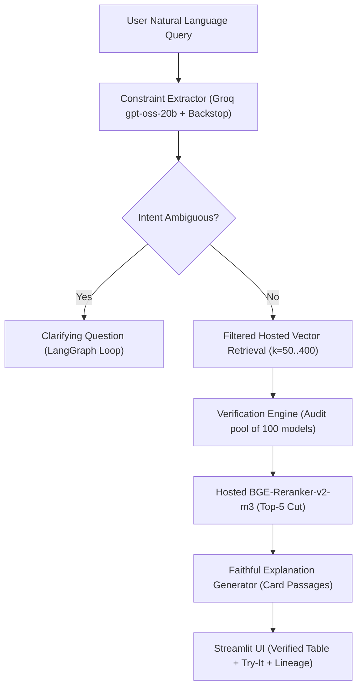

# HF Model Finder: Constraint-Verified RAG for Hugging Face Models
## Comprehensive Technical Report & Evaluation Write-Up

**Date:** October 2026  
**Repository:** [Adityarane012/RAG-Project](https://github.com/Adityarane012/RAG-Project)  
**Corpus Snapshot:** 9,764 models · 29,665 indexed chunks · Snapshot date: `2026-10-21`  
**Production Index:** Pinecone hosted index (`hf-model-finder`, `prod` namespace, 1,024-dim `multilingual-e5-large`)

---

## 1. Executive Summary & Problem Formulation

Finding appropriate machine learning models on the Hugging Face Hub for real-world deployments is fraught with subtle landmines:
1. **Hard constraint failures**: Models frequently violate licensing restrictions (e.g., non-commercial CC-BY-NC or custom research-only licenses disguised as permissive), exceed physical RAM/VRAM resource constraints, or fail target language requirements.
2. **Naive RAG hallucinations**: Standard retrieval-augmented generation pipelines embed user prompts, retrieve nearest-neighbor documentation, and rely on an LLM to generate recommendations. Because standard vector similarity measures topical closeness rather than logical compliance, naive RAG often returns models that directly violate hard constraints (50.4% violation rate on our test set).
3. **Hub keyword search limitations**: Hugging Face's native filter and keyword search tools suffer from high false-positive rates (25.9% to 32.8% violations) and leave critical metadata unverified.

**HF Model Finder** solves this through **Constraint-Verified RAG**:
- A LangGraph-based architecture decoupling semantic retrieval from deterministic metadata verification.
- **Code verifies; the LLM never decides compliance** (D2 design principle). Every recommendation is audited by a deterministic verification engine against declared licenses, parameter counts, architecture types, and language tags.
- Honest, tri-state compliance reporting: **✅ Pass**, **❌ Fail**, and **⚠️ Unknown** (when metadata or model cards are silent, the system explicitly marks them unknown rather than guessing).
- Interactive, multi-turn clarification when intent is ambiguous, and graceful degradation on impossible constraints.

---

## 2. System Architecture

### Core Architectural Pillars
1. **Deterministic Backstop & Sanitizer**: LLM constraint extraction (`openai/gpt-oss-20b`) is safeguarded by `clean_constraints` and a deterministic regex backstop to eliminate silent drops of size, language, or license constraints.
2. **Hosted Dual-Stage Retrieval & Reranking**: Pinecone hosted `multilingual-e5-large` embeddings combined with hosted `bge-reranker-v2-m3` reranker. To avoid dropping valid verified models that rank lower in raw text similarity, the system expands the verification pool to 100 models before cutting to the top 5 (`retrieval.verify_pool`).
3. **Separation of Verified Data & Explanations**: Citations and explanations are generated exclusively from verified card excerpts (`<card_section>` delimiters) with prompt-injection defense.
4. **Deterministic Replay & Offline Demo**: Every state transition can be frozen and served locally (`REPLAY=1`) without external network access.

---

## 3. Data Pipeline & Corpus Statistics

- **Corpus Scope**: 9,764 unique models across 5 core NLP/speech tasks (`automatic-speech-recognition`, `translation`, `text-classification`, `token-classification`, `sentence-similarity`), prioritizing the top 1,000 models per task by downloads plus all Indic-tagged models.
- **Total Chunks**: 29,665 chunks (mean 3.0 chunks per model after stripping boilerplate sections like training hyperparameters, bibtex, and citations).
- **Data Quality & Unknowns**:
  - **Unknown Size**: 27.2% (2,652 models) — primarily GGUF-only, ONNX-only, or non-standard weights.
  - **Unknown Commercial / Modifiable Rights**: 15.3% each.
  - **Unknown Language**: 12.9%.
  - **Indic-tagged Models**: 53.5% of the corpus.

---

## 4. Quantitative Evaluation & Benchmark Results

The evaluation suite was frozen prior to tuning across **100 diverse queries** (75 normal, 15 vague, 10 impossible).

### 4.1 System Comparison on Normal Queries (75 Queries)

| System | Answered % | Recs | Violation % | Unknown % | Fully Verified % | Median Latency (s) |
|---|---|---|---|---|---|---|
| **Ours (Constraint-Verified RAG)** | **97.3%** | 365 | **0.0%** | **16.7%** | **83.3%** | 0.22s |
| **Naive RAG** | 100.0% | 375 | 50.4% | 20.5% | 29.1% | 0.07s |
| **Keyword (BM25 + Filters)** | 100.0% | 368 | 0.0% | 62.0% | 38.0% | 0.05s |
| **HF Hub (Basic Filters)** | 100.0% | 375 | 32.8% | 13.6% | 53.6% | 0.10s |
| **HF Hub (Licensed Filters)** | 100.0% | 375 | 25.9% | 14.7% | 59.5% | 0.09s |

#### Breakdown of Violations by Constraint (% of recommended models failing)
- **Ours**: 0.0% across all constraints (commercial, direction, language, modifiability, size, task).
- **Naive RAG**: Fails size limits on **50.4%** of recommendations, task checks on **24.1%**, language checks on **19.4%**, and commercial license on **4.0%**.
- **HF Hub Licensed**: Fails size checks on **71.9%** of recommendations.

### 4.2 Behavior on Vague and Impossible Queries
- **Vague queries (15 queries)**: Our system asked a clarifying question on **100.0%** of vague queries. In contrast, all baselines answered blindly with unverified models.
- **Queries with no fully verified model in corpus (12 queries)**: Our system flagged 100% of these queries with the prominent *"No model is fully verified"* banner and made **0 false assurance claims**, whereas Naive RAG recommended violating models on **73.3%** of responses.

---

## 5. Relevance and Faithfulness Audits (LLM-judged)

**Who graded: independent Claude agents (LLM judges), not humans.** This is weaker evidence than human labelling and is reported as such
(provenance and limits: `eval/labels/PROVENANCE.md`; one-line reasons for every grade: `eval/labels/llm_judge_reasons.csv`).

**Method.** The blind relevance sheet has 686 (request, model) pairs over 40 queries: the union of the top 5 of ours, naive RAG, keyword
and the licensed Hub baseline, shuffled, with no system names. Eight agents each graded a batch by reading the request and the card
excerpt (0 = does not suit, 1 = plausible, 2 = clearly suits; size and license are checked automatically and not graded). Outputs were
frozen before grading (G4). A repeat pass by three different agents graded 15 of the queries (266 pairs) independently.

| System | Queries | Models graded | Mean grade (0 to 2) | Queries with a grade-2 model | Models graded 1 or 2 |
|---|---|---|---|---|---|
| **Ours** | 38 | 190 | **1.284** | **81.6%** | **76.8%** |
| Keyword | 40 | 197 | 1.061 | 65.0% | 70.1% |
| Naive RAG | 40 | 200 | 0.865 | 67.5% | 51.5% |
| HF Hub licensed | 40 | 200 | 0.685 | 22.5% | 61.5% |

Ours covers 38 queries because it asked a clarifying question on 2 of the 40 and recommended nothing. It has the highest mean grade and the
highest share of useful models, while also having 0% constraint violations; naive RAG retrieves related models but 50.4% of them break a hard constraint.

**Agreement between the two LLM passes (266 pairs):** identical grade on 92.1%; Cohen's kappa 0.874 (nominal) and 0.945 (quadratic-weighted);
no 0-versus-2 disagreements. This shows the judging is consistent; it does not show agreement with humans.

**Explanation faithfulness (28 explanations, 98 claims):** 80 claims (**81.6%**) are supported by the card passages the explainer was given, and
14 of 28 explanations (**50.0%**) have every claim supported. The unsupported claims are mostly statements the passages do not make: that a model
is suitable for commercial use or fits a size limit (these come from the request, not the card), that a multilingual model supports a named
language, or one wrong translation direction. The verification table is built from metadata, not from the explanation (D2), so these
wording errors do not change a ✅/❌/⚠️, but they show the explanation text must not be trusted as a source of constraint facts.

**Threats to validity.** LLM judges share the builder's model family; the queries were written by one person; the relevance grades judge
only the excerpt, not the whole card; 2 of 40 queries have no result for ours. A human check on a sample is the recommended strengthening.

---

## 6. Demo Replay Verification

The seven demo scenarios in `demo/plan.json` were recorded against live Pinecone and Groq (`python -m scripts.record_demo`), and
`python -m scripts.rehearse_demo` replays each from `demo/cache/` and fails if any is missing. What the recorded runs show:
1. **Small commercial Hindi sentiment**: "small" became a 500 MB limit; Ours returned 5 of 5 fully verified, while Naive RAG returned 4 of 5 failing the size limit.
2. **Commercial Hindi-to-Marathi translation**: direction is ⚠️ for every model, so no model is shown as fully verified.
3. **Vague request ("I want a Hindi model")**: the system asks which task is wanted before recommending anything.
4. **Marathi NER, commercial use**: Ours returned verified L3Cube and MuRIL NER models; Naive RAG returned speech-recognition models for a text task.
5. **Impossible request ("Hindi to Marathi translation under 1 MB")**: every result is ⚠️ and the banner says no model is fully verified.
6. **Urdu to English translation**: `opus-mt-ur-en` passes direction because the model name states it; the others stay ⚠️.
7. **Tamil NER, modifiable**: modifiable rights and LoRA memory estimates are shown.

This is an automated replay check. The two human rehearsals (one live, one in replay with Wi-Fi off) are still to do.

---

## 7. Limitations, Non-Goals, and Ethical Safeguards

1. **Not Legal Advice**: License rights are interpreted from author-declared license tags. Custom agreements or sub-clauses require human review.
2. **Declared vs. Ground Truth**: Metadata reflects what model authors posted to Hugging Face; the system cannot detect intentional deception in model cards.
3. **LLM-judged labels**: relevance and faithfulness were graded by Claude agents, not humans; the agreement figure is between two LLM passes. See §5.
3a. **Out-of-scope requests**: only five tasks are indexed (speech recognition, translation, text classification, named-entity recognition, sentence similarity). Requests about images, vision or OCR get a clear "not covered" message and no models.
4. **Prompt Injection Boundary**: Card passages are isolated with XML delimiters to neutralize adversarial model card text, ensuring that malicious documentation cannot compromise verification tables.
5. **Operational Key Hygiene**: API keys live only in the gitignored `.env`. They were pasted into a chat during the build, so they must be rotated after the project.

---

## 8. Milestone status

| Task | Description | Status | Evidence |
|---|---|---|---|
| H1 | Relevance grades, pass 1 (686 pairs, 40 queries) | Done by LLM judges (not human) | `eval/labels/labels_pass1.csv`, `PROVENANCE.md` |
| H2 | Faithfulness scoring (28 explanations) | Done by LLM judges (not human) | `eval/labels/faithfulness_labels.csv` |
| H3 | Relevance grades, repeat pass (266 pairs, 15 queries) | Done by different LLM judges | `eval/labels/labels_pass2.csv` |
| H4 | Reports | Done | `eval/results/relevance.md`, `eval/results/faithfulness.md` |
| H5 | Rehearsals | Automated replay check done; human rehearsals pending | `scripts/rehearse_demo.py`, `demo/cache/` |
| H6 | Write-up | Draft | `docs/writeup.md` |
| H7 | Snapshot as a GitHub Release asset, URL in `config.yaml` | Pending | `data/snapshot-2026-10-21/records.jsonl.gz` (local) |
| H8 | Rotate the Groq, Hugging Face and Pinecone keys | Pending, after the project | provider dashboards |
| Optional | Human spot-check of a sample of the grades | Not done | `eval/labels/PROVENANCE.md` |
