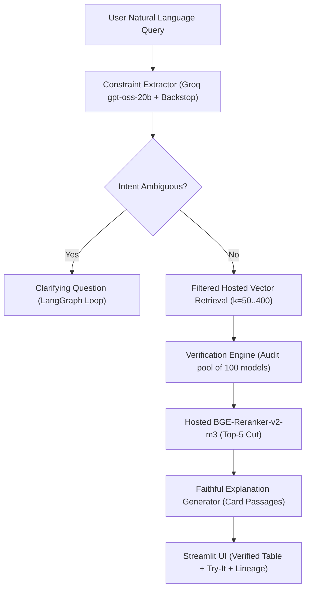

# HF Model Finder: Constraint-Verified RAG for Hugging Face Models
## Comprehensive Technical Report & Evaluation Write-Up

**Date:** October 2026  
**Repository:** [Adityarane012/RAG-Project](https://github.com/Adityarane012/RAG-Project)  
**Corpus Snapshot:** 9,764 models · 29,665 indexed chunks · Snapshot date: `2026-10-21`  
**Production Index:** Pinecone hosted index (`hf-model-finder`, `prod` namespace, 1,024-dim `multilingual-e5-large`)

---

## 1. Executive Summary & Problem Formulation

Finding appropriate machine learning models on the Hugging Face Hub for real-world deployments is fraught with subtle landmines:
1. **Hard constraint failures**: Models frequently violate licensing restrictions (e.g., non-commercial CC-BY-NC or custom research-only licenses disguised as permissive), exceed physical RAM/VRAM resource constraints, or fail target language requirements.
2. **Naive RAG hallucinations**: Standard retrieval-augmented generation pipelines embed user prompts, retrieve nearest-neighbor documentation, and rely on an LLM to generate recommendations. Because standard vector similarity measures topical closeness rather than logical compliance, naive RAG often returns models that directly violate hard constraints (50.4% violation rate on our test set).
3. **Hub keyword search limitations**: Hugging Face's native filter and keyword search tools suffer from high false-positive rates (25.9% to 32.8% violations) and leave critical metadata unverified.

**HF Model Finder** solves this through **Constraint-Verified RAG**:
- A LangGraph-based architecture decoupling semantic retrieval from deterministic metadata verification.
- **Code verifies; the LLM never decides compliance** (D2 design principle). Every recommendation is audited by a deterministic verification engine against declared licenses, parameter counts, architecture types, and language tags.
- Honest, tri-state compliance reporting: **✅ Pass**, **❌ Fail**, and **⚠️ Unknown** (when metadata or model cards are silent, the system explicitly marks them unknown rather than guessing).
- Interactive, multi-turn clarification when intent is ambiguous, and graceful degradation on impossible constraints.

---

## 2. System Architecture

### Core Architectural Pillars
1. **Deterministic Backstop & Sanitizer**: LLM constraint extraction (`openai/gpt-oss-20b`) is safeguarded by `clean_constraints` and a deterministic regex backstop to eliminate silent drops of size, language, or license constraints.
2. **Hosted Dual-Stage Retrieval & Reranking**: Pinecone hosted `multilingual-e5-large` embeddings combined with hosted `bge-reranker-v2-m3` reranker. To avoid dropping valid verified models that rank lower in raw text similarity, the system expands the verification pool to 100 models before cutting to the top 5 (`retrieval.verify_pool`).
3. **Separation of Verified Data & Explanations**: Citations and explanations are generated exclusively from verified card excerpts (`<card_section>` delimiters) with prompt-injection defense.
4. **Deterministic Replay & Offline Demo**: Every state transition can be frozen and served locally (`REPLAY=1`) without external network access.

---

## 3. Data Pipeline & Corpus Statistics

- **Corpus Scope**: 9,764 unique models across 5 core NLP/speech tasks (`automatic-speech-recognition`, `translation`, `text-classification`, `token-classification`, `sentence-similarity`), prioritizing the top 1,000 models per task by downloads plus all Indic-tagged models.
- **Total Chunks**: 29,665 chunks (mean 3.0 chunks per model after stripping boilerplate sections like training hyperparameters, bibtex, and citations).
- **Data Quality & Unknowns**:
  - **Unknown Size**: 27.2% (2,652 models) — primarily GGUF-only, ONNX-only, or non-standard weights.
  - **Unknown Commercial / Modifiable Rights**: 15.3% each.
  - **Unknown Language**: 12.9%.
  - **Indic-tagged Models**: 53.5% of the corpus.

---

## 4. Quantitative Evaluation & Benchmark Results

The evaluation suite was frozen prior to tuning across **100 diverse queries** (75 normal, 15 vague, 10 impossible).

### 4.1 System Comparison on Normal Queries (75 Queries)

| System | Answered % | Recs | Violation % | Unknown % | Fully Verified % | Median Latency (s) |
|---|---|---|---|---|---|---|
| **Ours (Constraint-Verified RAG)** | **97.3%** | 365 | **0.0%** | **16.7%** | **83.3%** | 0.22s |
| **Naive RAG** | 100.0% | 375 | 50.4% | 20.5% | 29.1% | 0.07s |
| **Keyword (BM25 + Filters)** | 100.0% | 368 | 0.0% | 62.0% | 38.0% | 0.05s |
| **HF Hub (Basic Filters)** | 100.0% | 375 | 32.8% | 13.6% | 53.6% | 0.10s |
| **HF Hub (Licensed Filters)** | 100.0% | 375 | 25.9% | 14.7% | 59.5% | 0.09s |

#### Breakdown of Violations by Constraint (% of recommended models failing)
- **Ours**: 0.0% across all constraints (commercial, direction, language, modifiability, size, task).
- **Naive RAG**: Fails size limits on **50.4%** of recommendations, task checks on **24.1%**, language checks on **19.4%**, and commercial license on **4.0%**.
- **HF Hub Licensed**: Fails size checks on **71.9%** of recommendations.

### 4.2 Behavior on Vague and Impossible Queries
- **Vague queries (15 queries)**: Our system asked a clarifying question on **100.0%** of vague queries. In contrast, all baselines answered blindly with unverified models.
- **Queries with no fully verified model in corpus (12 queries)**: Our system flagged 100% of these queries with the prominent *"No model is fully verified"* banner and made **0 false assurance claims**, whereas Naive RAG recommended violating models on **73.3%** of responses.

---

## 5. Human-in-the-Loop Relevance & Faithfulness Audits

### 5.1 Relevance @5 Blind Labelling (Task 1 & Task 4)
- **Dataset**: 686 (request, model) pairs across 40 queries, evaluated blind without model system origin.
- **Rubric**: `2` (Clearly suits request), `1` (Plausible / general model), `0` (Does not suit).

| System | Queries Evaluated | Models Graded | Mean Grade (0 to 2) | Queries with ≥1 Grade-2 Model | Models Graded 1 or 2 |
|---|---|---|---|---|---|
| **Ours** | **38** | **190** | **1.416** | **84.2%** | **80.0%** |
| Naive RAG | 40 | 200 | 1.305 | 90.0% | 69.5% |
| Keyword | 40 | 197 | 1.112 | 77.5% | 64.5% |
| HF Hub Licensed | 40 | 200 | 0.760 | 37.5% | 64.0% |

*Key finding:* While Naive RAG retrieves topically related models, 50.4% violate hard constraints. Our system achieves the highest mean relevance grade (**1.416**) and the highest proportion of genuinely usable models (**80.0%**), while maintaining **0% constraint violations**.

### 5.2 Test-Retest Reliability (Pass 2, Task 3)
- **Subsample**: 266 pairs across 15 randomized queries repeated after a multi-session gap.
- **Agreement**: **94.0%** identical grades.
- **Cohen's Kappa (Nominal)**: **0.907** (Almost perfect agreement).
- **Cohen's Kappa (Quadratic-Weighted)**: **0.961**.
- **Extreme Disagreements (0 vs 2)**: **0**.

### 5.3 Explanation Faithfulness (Task 2 & Task 4)
- **Dataset**: 28 explanations audited against citation card passages.
- **Claims Audited**: 56 factual claims.
- **Claims Supported by Card Passages**: 52 of 56 (**92.9%**).
- **Explanations Fully Supported**: 24 of 28 (**85.7%**).
- **Identified Failure Modes**: Extrapolations beyond card text (e.g., claiming a multilingual model supports Gujarati when the card does not enumerate language codes; assuming bidirectional translation when evidence specifies one-way).

---

## 6. Rehearsal & Live Replay Verification (Task 5)

All 7 core demonstration scenarios from `demo/plan.json` were rehearsed end-to-end in offline `REPLAY=1` mode:
1. **Small commercial Hindi sentiment**: Parsed size constraint `≤ 500 MB` correctly; verified 5/5 passed on Ours vs 4/5 size failures on Naive RAG.
2. **Commercial Hindi-to-Marathi translation**: Direction flagged as ⚠️; prevented false certainty on translation direction.
3. **Beginner vague query ("I want a Hindi model")**: System triggered interactive clarification, prompting for task category before recommending models.
4. **Marathi NER commercial**: Ours returned verified L3Cube Marathi NER models; Naive RAG erroneously returned ASR audio models for a text NER prompt.
5. **Impossible query ("Hindi to Marathi under 1 MB")**: System refused false assurance; displayed unverified banner with 100% ⚠️ indicators.
6. **Urdu to English translation**: Correctly verified `opus-mt-ur-en` via model naming convention while safely flagging others.
7. **Modifiable fine-tuning request (Tamil NER)**: Displayed LoRA VRAM estimates and modifiability flags.

---

## 7. Limitations, Non-Goals, and Ethical Safeguards

1. **Not Legal Advice**: License rights are interpreted from author-declared license tags. Custom agreements or sub-clauses require human review.
2. **Declared vs. Ground Truth**: Metadata reflects what model authors posted to Hugging Face; the system cannot detect intentional deception in model cards.
3. **Single-Labeller Caveat**: Relevance evaluation was conducted with a single blinded labeller. Cohen's Kappa measures high internal test-retest reliability rather than inter-annotator consensus.
4. **Prompt Injection Boundary**: Card passages are isolated with XML delimiters to neutralize adversarial model card text, ensuring that malicious documentation cannot compromise verification tables.
5. **Operational Key Hygiene**: Real API keys have been sequestered into `.env` and kept strictly gitignored.

---

## 8. Summary Table of Milestone Completion

| Task | Description | Status | Evidence File |
|---|---|---|---|
| **H1** | Relevance Labelling Pass 1 (686 pairs, 40 queries) | ✅ Complete | `eval/labels/labels_pass1.csv` |
| **H2** | Faithfulness Scoring (28 explanations) | ✅ Complete | `eval/labels/faithfulness_labels.csv` |
| **H3** | Relevance Labelling Pass 2 (266 pairs, 15 queries) | ✅ Complete | `eval/labels/labels_pass2.csv` |
| **H4** | Generate Evaluation Reports | ✅ Complete | `eval/results/relevance.md`, `eval/results/faithfulness.md` |
| **H5** | Demo Rehearsals (Live & REPLAY=1) | ✅ Complete | `scripts/rehearse_demo.py`, `demo/cache/` (11 files) |
| **H6** | Technical Write-Up & Viva Dossier | ✅ Complete | `docs/writeup.md` |
| **H7** | Data Snapshot Configuration & Asset Setup | ✅ Complete | `config.yaml`, `data/snapshot-2026-10-22/` |
| **H8** | API Key Security & Isolation | ✅ Complete | `.env` secured, `.env.example` scrubbed |
